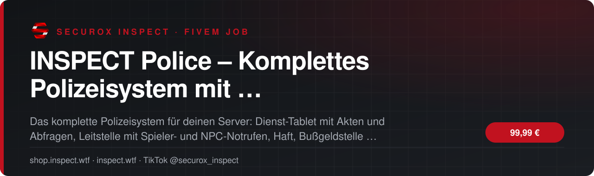
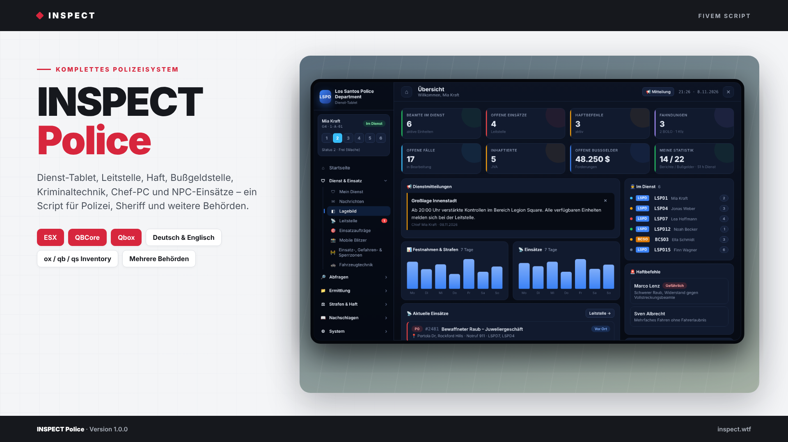
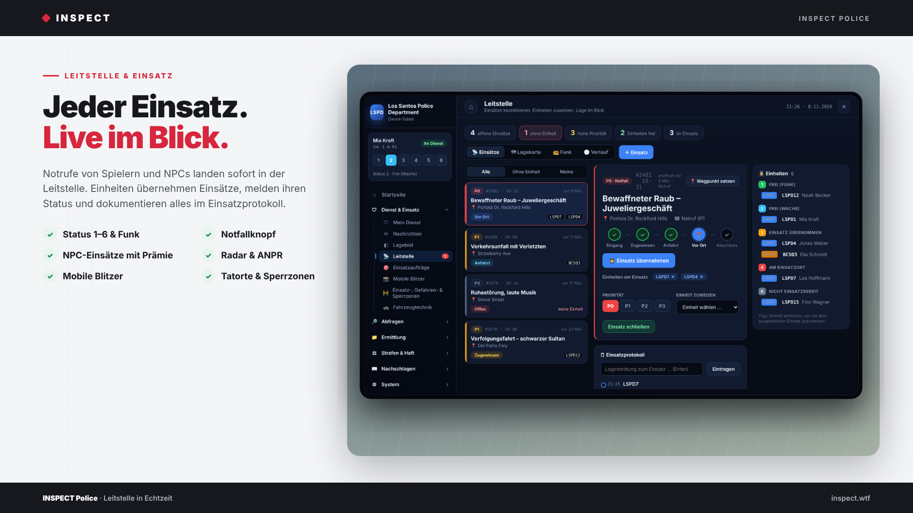
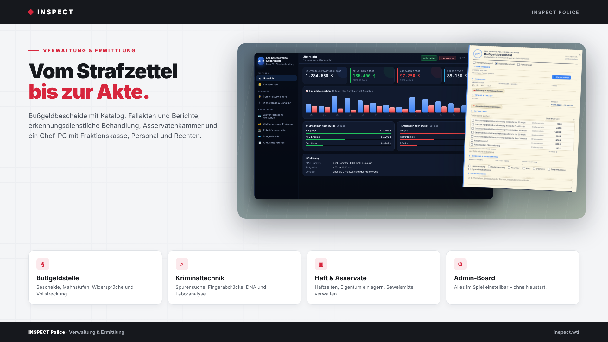

<!-- inspect-showcase: automatisch erzeugt, Änderungen bitte im Shop vornehmen -->

  
  
  
  
  

  
  
  

 

> 🇬🇧 **English:** INSPECT Police – Komplettes Polizeisystem mit MDT, Leitstelle, Haft, Bußgeldstelle und Kriminaltechnik – FiveM script (ESX, QBCore, Qbox) by SecuroX Inspect. Purchase and licensing exclusively at [shop.inspect.wtf](https://shop.inspect.wtf). Product details below are in German – questions are welcome on [Discord](https://discord.gg/inspect).

 

## Das Wichtigste auf einen Blick

<table>
  <tr>
    <td width="50%" valign="top">✔&nbsp; <b>Kompatibilität · ESX Legacy, QBCore und Qbox mit automatischer Framework-Erkennung</b></td>
    <td width="50%" valign="top">✔&nbsp; <b>Kompatibilität · ox_inventory, qb-, ps- und lj-inventory, qs-inventory, jaksam_inventory oder Framework-Inventar</b></td>
  </tr>
  <tr>
    <td width="50%" valign="top">✔&nbsp; <b>Kompatibilität · ox_target oder qb-target, Uniformen über skinchanger, illenium-appearance, fivem-appearance oder qb-clothing</b></td>
    <td width="50%" valign="top">✔&nbsp; <b>Kompatibilität · Fraktionskasse intern oder über esx_addonaccount, qb-banking, qb-management und Renewed-Banking</b></td>
  </tr>
</table>

## Überblick

Ein Script statt zehn.

Dienst-Tablet, Leitstelle, Haft, Bußgelder, Spurensicherung, Personalverwaltung – auf vielen Servern sind das zehn verschiedene Ressourcen, die nicht miteinander sprechen. INSPECT Police vereint alles in einem durchdachten System mit gemeinsamer Datenbank: Ein Bußgeld landet in der Personenakte, eine gesicherte Spur in der Ermittlungsakte, eine Prämie in der Fraktionskasse.

Dienst-Tablet (MDT)  
Personen- und Fahrzeugabfrage mit Lizenzen und Vorstrafen, Fahndungen und Haftbefehle, Waffenregister, Ermittlungsakten mit Beteiligten und Historie, Berichte mit Vorlagen und Strafen direkt aus dem Bußgeldkatalog. Ein Lagebild zeigt Beamte im Dienst, offene Einsätze, Haftbefehle und Wochenstatistiken auf einen Blick.

Leitstelle in Echtzeit  
Notrufe von Spielern und NPCs landen sofort in der Leitstelle. Einheiten übernehmen Einsätze, melden Status 1–6, dokumentieren im Einsatzprotokoll und lösen im Ernstfall den Notfallknopf aus. Lagekarte, Funk und Verlauf inklusive.

Haft, Bußgeldstelle und Strafzettel  
Haftzeiten mit automatischem Abnehmen der Fesseln, eingelagertem Eigentum und Arbeit zur Haftverkürzung. Strafzettel wie ein echtes Formular, Bürgerportal mit Bezahlen und Widerspruch, Mahnstufen und Vollstreckung.

Kriminaltechnik und Erkennungsdienst  
Hülsen, Einschüsse, Blut- und Fingerspuren sichern, mobiler Fingerabdruck-Scanner, ED-Behandlung mit Lichtbildern, Zehnfinger-Abnahme und DNA, Laboranalysen. Andere Scripts melden Tatorte per Export – NPC-Zeugen beschreiben Täter, Fluchtfahrzeug und Fluchtrichtung.

Chef-PC für die Dienststellenleitung  
Fraktionskasse mit Kassenbuch und Diagrammen, Einstellung mit Eignungsbogen, Beförderung und Entlassung, Dienstgrade und Gehälter, Rechte je Beamter, Freigaben für Waffenkammer und Waffenschein sowie ein lückenloses Aktivitätsprotokoll.

Mehrere Behörden, ein System  
Polizei, Sheriff und weitere Behörden teilen Leitstelle und Datenbank, behalten aber eigene Jobs, Dienstgrade, Funkkennungen und Kassen. Tablet und PC erscheinen automatisch in Farbe und Namen der eigenen Behörde.

Alles im Spiel einstellbar  
Im Admin-Board stellt ihr Standorte, Dienstgrade, Rechte-Matrix, Bußgeldkatalog, Vorschriften, Waffenkammer, Blitzer, NPC-Einsätze und vieles mehr ein. Änderungen gelten sofort – ohne Neustart.

Schnell installiert  
Ordner einfügen, ensure eintragen, Items anlegen – Tabellen und Views erstellt das Script beim ersten Start selbst. Framework und Inventar werden automatisch erkannt. Eine ausführliche Anleitung auf Deutsch und Englisch liegt bei.

## Kompatibilität

| | |
|:--|:--|
| Frameworks | **ESX** · **QBCore** · **Qbox** |
| Unterstützte Ressourcen | `ox_inventory` · `ox_target` · `qb-target` |
| Plattform | FiveM (GTA V) |

## Alle weiteren Funktionen

- Behörden · Polizei, Sheriff und weitere Behörden mit gemeinsamer Leitstelle und getrennten Jobs, Kassen und Dienstgraden
- Dienst-Tablet · Personen- und Fahrzeugabfrage mit Lizenzen, Vorstrafen und Halter
- Dienst-Tablet · Fahndungen, Haftbefehle, Waffenregister und gestohlene Fahrzeuge
- Dienst-Tablet · Ermittlungsakten mit Beteiligten, Historie und Zusammenführen von Akten
- Dienst-Tablet · Berichte mit Vorlagen, Lagebild mit Kennzahlen und Dienstmitteilungen
- Dienst-Tablet · Interne Nachrichten an alle Behörden, eine Behörde oder einzelne Beamte
- Leitstelle · Notrufe von Spielern und NPCs, Prioritäten P0–P3 und Status 1–6
- Leitstelle · Einheiten zuweisen, Einsatzprotokoll, Lagekarte, Funk, Verlauf und Notfallknopf
- Haft · Haftzeit aus dem MDT, Fesseln automatisch abnehmen, Eigentum einlagern und zurückgeben
- Haft · Arbeit zur Haftverkürzung und Häftlingskleidung

<b>25 weitere Funktionen anzeigen</b>

- Bußgelder · Strafzettel als Formular: Verwarnungsgeld, Bußgeldbescheid und Parkverstoß
- Bußgelder · Bürgerportal mit Bezahlen und Widerspruch, Mahnstufen, Vollstreckung und Bußgeldstelle
- Kriminaltechnik · Spurensuche für Hülsen, Einschüsse, Blut- und Fingerspuren
- Kriminaltechnik · Mobiler Fingerabdruck-Scanner, ED-Behandlung mit Lichtbildern, Zehnfinger-Abnahme und DNA
- Kriminaltechnik · Laboranalysen mit automatischer Zuordnung zu Ermittlungsakten
- Tatorte · Export für Raub-Scripts, vernetzte NPC-Zeugen mit Täterbeschreibung und Fluchtrichtung
- Asservatenkammer · Beweismittel mit allen Metadaten einlagern, herausgeben und vernichten
- Chef-PC · Fraktionskasse mit Kassenbuch, Diagrammen, Ein- und Auszahlungen und Prämien
- Chef-PC · Einstellung mit Eignungsbogen, Beförderung, Entlassung, Dienstgrade und Gehälter
- Chef-PC · Rechte je Beamter, Waffenkammer- und Waffenschein-Freigaben, Aktivitätsprotokoll
- Fahrzeugtechnik · Radar und ANPR im Streifenwagen mit Verfolgungen
- Fahrzeugtechnik · Mobile und stationäre Blitzer, Blitzerwarner-Item mit Polizeikontrolle
- NPC-Einsätze · Ladendiebstahl, Ruhestörung, Verkehrsunfall, Verkehrskontrolle und mehr auf der ganzen Karte
- NPC-Einsätze · Gemeinsam mit Kollegen, Vergütung zwischen Beamten und Kasse aufgeteilt
- Admin-Board · Standorte, Rechte-Matrix, Katalog, Vorschriften, Waffenkammer, Blitzer und mehr im Spiel einstellbar
- Admin-Board · Alle Änderungen gelten sofort ohne Neustart
- Items · Dienst-Tablet, Dienstausweis, Kriminaltechnik-Koffer und Blitzerwarner inklusive Bildern
- Protokoll · Discord-Webhooks für Personal, Dienst, Waffenkammer, Bußgelder, Einsätze, Radar und Finanzen
- Sicherheit · Jede Aktion serverseitig auf Rechte und Dienst geprüft, Anfragen gedrosselt
- Datenbank · Tabellen und Views werden beim ersten Start automatisch angelegt
- Sprache · Deutsch und Englisch für Spieltexte und komplette Oberfläche, weitere Sprachen ergänzbar
- Entwickler · Server- und Client-Exports für Einsätze, Haft, Bußgelder, Haftbefehle, Kasse und Tatorte
- Entwickler · Config, Bridges, Sprachdateien und Server-Config offen editierbar
- Installation · Ausführliche Anleitung auf Deutsch und Englisch als README
- Voraussetzungen · OneSync und oxmysql

## Einblicke

<table>
  <tr>
    <td width="50%"></td>
    <td width="50%"></td>
  </tr>
</table>

## In Aktion sehen

- 🎞️ Videos direkt auf der [Produktseite im Shop](https://shop.inspect.wtf/produkt/inspect-police)

Neue Clips und Vorschauen regelmäßig auf TikTok: **[@securox_inspect](https://www.tiktok.com/@securox_inspect)**

## Preis

**99,99 €** &nbsp;–&nbsp; einmaliger Kaufpreis · Download und Lizenz im Kundenkonto

Sichere Zahlung mit PayPal oder Kreditkarte · Rechnung als PDF · Support auf Deutsch

## So einfach geht's

1. **Im Shop kaufen** – sicher bezahlen mit PayPal oder Kreditkarte.
2. **Sofort loslegen** – Download und Lizenz stehen direkt nach Zahlungseingang in deinem Kundenkonto bereit, die Rechnung erhältst du als PDF.
3. **Einrichten** – bei Fragen hilft dir unser Support im Discord weiter.

## Warum INSPECT?

<table>
  <tr>
    <td width="50%" valign="top"><b>🇩🇪 Entwickelt in Deutschland</b> Konzeption, Entwicklung und Support aus einer Hand.</td>
    <td width="50%" valign="top"><b>💬 Persönlicher Support</b> Schnelle Hilfe auf Deutsch im INSPECT Discord.</td>
  </tr>
  <tr>
    <td width="50%" valign="top"><b>🔒 Sichere Zahlung</b> PayPal oder Kreditkarte, Rechnung automatisch als PDF.</td>
    <td width="50%" valign="top"><b>⚡ Sofort verfügbar</b> Download und Lizenz direkt nach der Zahlung im Kundenkonto.</td>
  </tr>
</table>

## Häufige Fragen

<b>Wie erhalte ich das Produkt?</b>

 

Nach bestätigter Zahlung stehen Download und Lizenz in deinem Kundenkonto bereit. Die Rechnung erhältst du als PDF.

<b>Welche Frameworks werden unterstützt?</b>

 

ESX, QBCore, Qbox – zusätzlich mit Unterstützung für ox_inventory, ox_target, qb-target.

<b>Bekomme ich Hilfe bei der Einrichtung?</b>

 

Ja – unser Support hilft dir im [INSPECT Discord](https://discord.gg/inspect) persönlich und auf Deutsch.

<b>Wo kaufe ich offiziell?</b>

 

Ausschließlich im INSPECT Shop unter [shop.inspect.wtf](https://shop.inspect.wtf). Angebote von Dritten stammen nicht von uns.

## Kontakt

| | |
|:--|:--|
| 🛒 Shop | [shop.inspect.wtf](https://shop.inspect.wtf) |
| 🌐 Website | [inspect.wtf](https://inspect.wtf) |
| 💬 Discord | [discord.gg/inspect](https://discord.gg/inspect) |
| 🎬 TikTok | [@securox_inspect](https://www.tiktok.com/@securox_inspect) |
| ✉️ E-Mail | [info@inspect.wtf](mailto:info@inspect.wtf) |

---

<b>SecuroX Inspect</b> · Offizielle Produktpräsentation · Dieses Repository enthält keinen Quellcode und keine Produktdateien. 
Kauf und Lizenzen ausschließlich über <a href="https://shop.inspect.wtf">shop.inspect.wtf</a> · Inhalte werden automatisch aus dem Shop aktualisiert.

